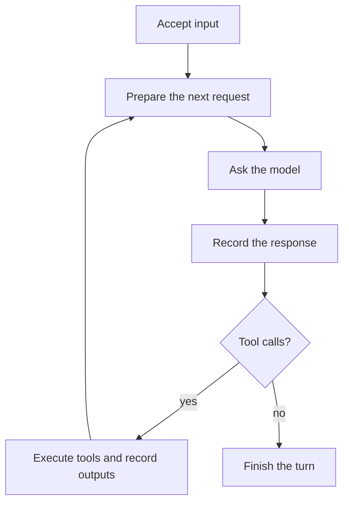

# Follow the model–tool loop

**Proposed design; production has not been migrated.** A turn starts with accepted
input and runs this loop:



The central implementation should read like that diagram. In illustrative
pseudocode, including an explicit completion-policy extension:

```text
async runTurn(turn):
    repeat:
        request = await prepareRequest(turn)
        response = await askModel(turn, request)
        recordResponse(turn, response)

        if response has tool calls:
            await executeTools(turn, response.toolCalls)
        else:
            if await finishTurn(turn, response) == done:
                return
```

Ordinarily, no tool calls means the turn ends. `finishTurn` may wait for a required
post-execution decision. If existing completion policy requests another model
round, it returns `continue` to this loop; it cannot secretly start another loop.
Errors and Stop exit through the turn owner's cleanup boundary.

Each feature has a place around this flow:

| Feature | Where the reader goes | What it does |
| --- | --- | --- |
| Follow-ups, editing, retracting | Conversation inbox, outside `runTurn` | Keep accepted input editable until consumed; start the next eligible turn after this one settles. |
| Steering | `prepareRequest` | Consume eligible steer input at the next request boundary; unconsumed steers return to queue policy when the turn ends. |
| Prompts, modes, skills and tool availability | `prepareRequest` | Assemble instructions and the request's tool snapshot; execution still checks tool authority. |
| Context limits and compaction | `prepareRequest` | Build a valid request from accepted history, applying context policy before dispatch. |
| Streaming and provider protocols | `askModel` | Publish incremental output, retain committed facts, and translate the provider's response into the loop's common form. |
| Retry | Inside `askModel`, under retry policy | Retry a safe request attempt using the same turn budget; uncertain tool work is never replayed by request retry. |
| Approval and ask-user | `executeTools` | Wait at the relevant tool, then continue the same tool plan. |
| Parallel tools | `executeTools` | Dispatch eligible independent calls together; settle their results in the required order before the next model request. |
| Background tools and child tasks | `executeTools`, backed by owned executions | Return a job handle when backgrounding is accepted; retain the running job and deliver eligible results as later input. |
| Budgets | Request and tool boundaries | Apply the existing policy before more work; a grant continues the same turn with the same accounting. |
| Stop | Turn owner, around the loop | Revoke advancement, interrupt waits, request execution stop, and settle history. Replacement admission waits for the applicable stop proof. |
| Rollover and restart | Conversation lifecycle, outside the loop | Change context and eligible work ownership. Restart does not automatically resume the interrupted loop. |
| UI and persistence | Observe events; journal accepted facts | Show progress and retain history without independently deciding which step runs next. |

An `await` for approval leaves the UI and command handling responsive. It does not
hold the JavaScript event loop. A tool result describes what is known; stop proof
describes whether its execution can still make effects. That distinction stays
inside execution ownership and cleanup rather than becoming another top-level
flowchart. Known pre-cancellation outcomes remain facts; later results cannot revive
the revoked turn.

A human should first open `runTurn`, then follow **one operation** to answer a
specific question: “Why are we waiting for approval?” → `executeTools`; “Why this
model input?” → `prepareRequest`; “Why won't the next turn start?” → conversation
admission and execution cleanup.

The [detailed design](conversation-loop.md) defines these operations, shows a worked
turn, maps current owners, and specifies what must disappear during migration.
The [v2 experiment](../../experiments/conversation-actor/v2/DESIGN.md) remains
historical evidence about ownership and cancellation rules. Its event-driven actor
is not the proposed central implementation. Human readability and production
parity still need to be demonstrated.
