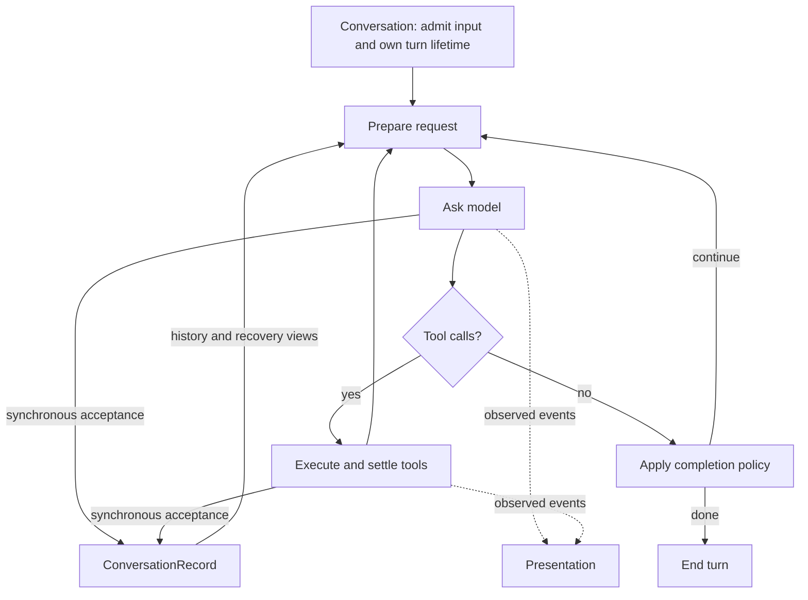

# Follow the model–tool loop

`ApplicationRunLoop.#runTurn` in
[`application-run-loop.ts`](../../source/services/agent-runtime/application-run-loop.ts)
owns execution advancement. In the root session path,
[`ConversationRecord`](../../source/services/conversation/conversation-record.ts)
owns acceptance of provider history, tool evidence and assistant journal items.
Presentation observes those facts; it does not commit them.

The control cycle is model → tools → model. Acceptance happens during that cycle,
before the runtime publishes the corresponding event to observers. It is not a
later step that a UI consumer must finish before execution may proceed.

The root session supplies bounded callbacks through `ApplicationTurnSession`.
`SessionTurnAdapter.#acceptEvent` routes observed items and streaming fragments to
Record. `acceptToolDispatch` records dispatch evidence before a tool body can run.
`#acceptSegment` commits the segment's terminal representation through Record and
then updates provider continuity. `#consume` and `SessionStreamProcessor.process`
build presentation state, command deduplication and usage views.
`ConversationLogger` writes log events without replaying them to repair live
history.

Record privately owns `ConversationStore`, `ToolExecutionLedger` and
`AssistantTurnJournal`. Its operations decide history selection, preserve native
tool evidence, reconstruct recovery history, and keep rewind/reset/import changes
together. `beginSegment` retains a baseline so streamed accepted items and a
terminal history view can be reconciled without appending the same segment twice.
These representations still exist; their mutation rights no longer escape to
session callers.

The runtime still maintains request-local input, history and continuation views
for provider serialization, compaction and approval suspension. Those transport
views are not a second public conversation record. Submission records also remain
separate: they own queued input identity, edit/retract rules and delivery receipts.

The important side contracts are:

| Concern | Owner and contract |
| --- | --- |
| Approval and ask-user | Tool execution awaits an addressed decision. Answering resumes the existing turn; it does not start another stream-driving loop. |
| Retry and recovery | Retry modules classify failures and select policy. Record reconstructs accepted evidence; `#runTurn` owns the next attempt. Completed and uncertain effects remain distinguishable. |
| Stop and background work | Turn cancellation revokes advancement. Concrete shell/child registries retain physical execution authority and applicable stop proof; a cancelled await alone proves no process stopped. |
| Persistence | Record delivers journal writes under the existing best-effort session sink policy. A sink acknowledgement is not proof of fsync; direct durable writer gates retain their own contracts. |
| Provider continuity | Session continuity publication uses Record's accepted segment receipt. Provider-specific continuation and opaque-history rules remain separate from acceptance. |
| Context and completion policy | Request preparation owns compaction and request limits. `#finishTurn` makes an explicit continuation decision when existing completion policy requires another round. |

An approval await leaves UI commands responsive. A steer received while waiting
becomes eligible at the next request boundary; it does not alter accepted tool
arguments retroactively. Known outcomes remain evidence after cancellation;
physical work that may still produce effects remains an execution-owner concern.

Open `#runTurn` first, then follow the relevant operation. The
[detailed design](conversation-loop.md) maps the boundaries and remaining
complexity. The [v2 experiment](../../experiments/conversation-actor/v2/DESIGN.md)
is historical ownership and cancellation evidence; its event-driven actor is not
the production execution structure. Earlier implementation evidence remains in
[WORK.md](../research/single-turn-owner/WORK.md). Source structure and passing
workflows do not establish that human comprehension improved; that remains
unmeasured.
