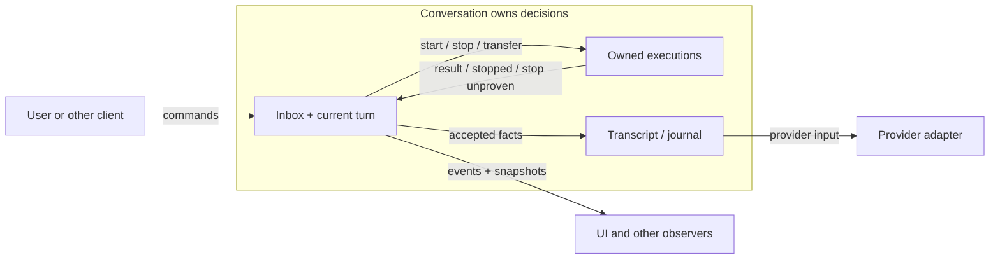

# A conversation, a turn, and the work it owns

**Proposed design, not the current production architecture.** The goal is to make
Term2 explainable without tracing its internal services. The executable model and
production deletion map are [beside the experiment](../../experiments/conversation-actor/v2/DESIGN.md).

A **conversation** receives input and owns the decision about what happens next.
It has an inbox, a transcript, and at most one foreground **turn**. A turn is a
computation that asks a model, runs tools, and repeats. Waiting for approval or a
retry leaves that same turn in place. An **execution** is work that actually runs:
a model request, tool, shell process, or child task. Its lifetime can extend beyond
the turn that started it.

To follow a turn, ask three questions:

1. **What input has the conversation accepted?** One submission record holds its
   identity, executable payload, position, delivery target, and eventual outcome.
   Editing and retracting address that record until it is consumed. A steer waits
   there for the current turn's next model boundary. If no boundary follows, the
   conversation returns it to ordinary queue policy.
2. **What is this turn waiting for?** One stored continuation answers: model output,
   a tool outcome, approval, retry, or reconciliation. Answering approval resumes
   that continuation. Other components do not maintain independent turn status.
3. **What work is still alive?** Each execution has one owner and identity. A result
   says what is known; stop evidence says it cannot continue making effects within
   its execution contract. Either can arrive first; a live foreground continuation
   needs both. Cancellation revokes the turn's
   right to advance immediately, asks its work to stop, and keeps replacement work
   behind a barrier until retired foreground and session executions are proved
   stopped. Known outcomes received before revocation remain facts; later results
   cannot change the cancelled turn's transcript. Normal background work does not
   block admission.

Backgrounding changes the owner of an existing execution; it does not restart it.
A background execution can report after its original turn ends. Rollover changes
the conversation's context and journal destination, while eligible executions keep
their identity and report to the successor. Retired work cannot regain permission
to change the successor's turn or history.

The journal owns durable facts and their order. The conversation decides which
facts to accept. Provider history is a projection of accepted facts, with complete
tool pairs; transport anchors are adapter-owned reuse hints. A broken anchor
cannot become the only copy of conversation history. UI state is an observation
of this system, not another place to make scheduling decisions.

The production design must preserve queue policy: input retained by Stop remains
paused; fresh input can become eligible after stop proof; restart recovery requires
explicit resume. Those are policies over submission records, not additional turn
controllers. A persistence failure remains visible as local-only state rather than
a claim of durable success.

This design does **not** make tool ambiguity, persistence, provider protocols, or
approval authority disappear. It gives them a place to live so that explaining a
turn does not require learning each implementation. Fewer files is not the goal;
fewer independent decisions about the same lifecycle is.
