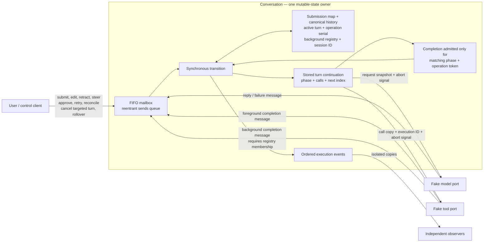
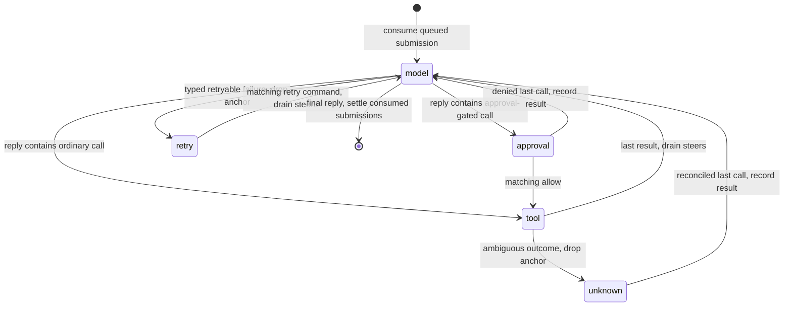

# Conversation actor — one-page architecture

For a multi-call response, a settled/denied/reconciled call advances to the next
call (and approval if required); the diagram abbreviates those edges. Launching
a background call registers independent work and records its handle as the call
result; the workflow continues immediately. Job completion appends a notification
even while idle, without opening an unsolicited model turn.

Cancel from any active phase revokes the turn before cooperative abort, repairs
unfinished call/result pairs, settles consumed submissions, and returns unconsumed
steers. Rollover additionally resets history/anchor and session-scoped jobs;
conversation-scoped jobs keep the same execution and report to the successor.
Each await lives in a port; the actor's continuation is explicit data, not a
second asynchronous controller. Cancellation cannot prove physical tool exit.
